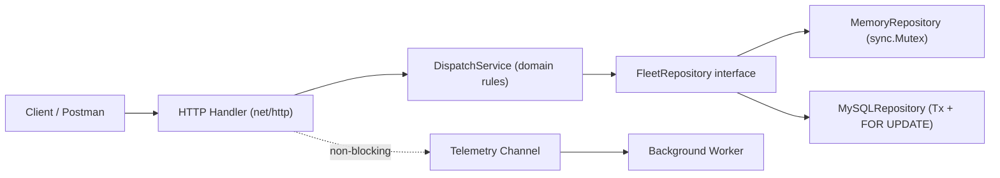
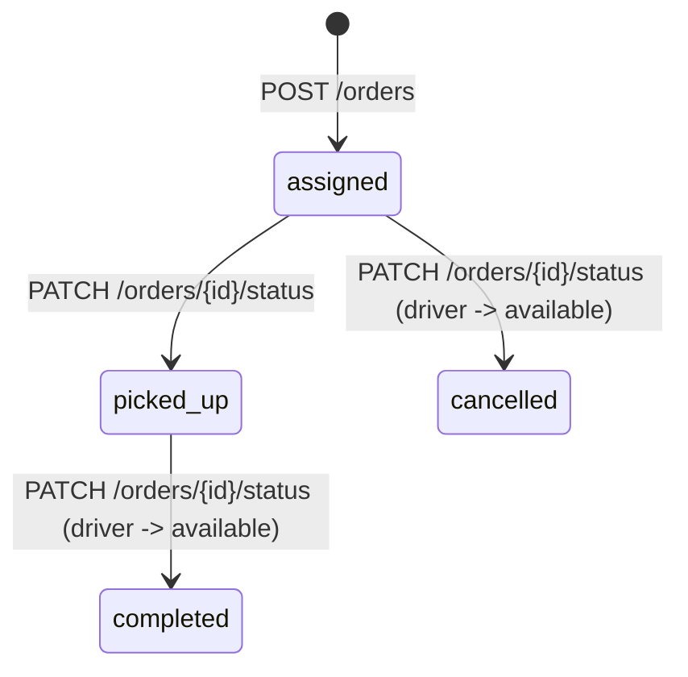

# Fleet Dispatch Service (`fleet-dispatch-go`)

Layanan backend Go untuk simulasi dispatch armada taksi: mencari driver `available` terdekat dari titik jemput penumpang, mencegah *double booking* saat banyak request masuk bersamaan, dan menjaga urutan status perjalanan lewat *state machine*.

Proyek ini mendukung dua backend penyimpanan melalui kontrak `FleetRepository`: `MemoryRepository` (berbasis `sync.Mutex` untuk pengujian cepat) dan `MySQLRepository` (berbasis transaksi SQL `BeginTx` dan `SELECT ... FOR UPDATE`).

## Arsitektur & Alur Status





## Fitur Utama

1. **Manajemen Driver & Telemetry Lokasi**
   - `POST /drivers` mendaftarkan driver dengan validasi koordinat `[-90, 90]` / `[-180, 180]` dan keunikan `nomor_lambung` (`409 Conflict` jika duplikat).
   - `PATCH /drivers/{id}/location` memperbarui posisi GPS dan status, menjaga invarian agar driver `on_trip` tidak bisa diubah manual menjadi `available` atau `offline`, serta mengirim event non-blocking ke *buffered channel* telemetry worker.
2. **Auto-Dispatch Terdekat & Anti Double-Booking**
   - `POST /orders` menghitung jarak titik jemput ke seluruh driver `available` dengan rumus Haversine dan memilih yang terdekat.
   - Penguncian driver memakai `sync.Mutex` (pada `MemoryRepository`) atau transaksi `SELECT ... FOR UPDATE` (pada `MySQLRepository`) agar request bersamaan tidak bisa memesan driver yang sama.
3. **State Machine Status Perjalanan**
   - `PATCH /orders/{id}/status` hanya mengizinkan transisi `assigned` -> `picked_up` -> `completed` atau `assigned` -> `cancelled`.
   - Status yang tidak dikenal ditolak dengan `400 Bad Request`; transisi yang melompat ditolak dengan `409 Conflict`.
   - Saat order mencapai `completed` atau `cancelled`, driver otomatis kembali menjadi `available`.

## Struktur Proyek

```text
fleet-dispatch-go/
├─ .github/workflows/ci.yml           # GitHub Actions (go vet & go test -race)
├─ cmd/api/main.go                    # Wiring dependency, telemetry worker, graceful shutdown
├─ internal/
│  ├─ domain/
│  │  ├─ driver.go                    # Entity Driver, validasi koordinat, sentinel errors
│  │  ├─ order.go                     # Entity Order, state machine, rumus Haversine & tarif
│  │  └─ order_test.go                # Unit test domain (100% coverage)
│  ├─ repository/
│  │  ├─ interfaces.go                # Interface FleetRepository
│  │  ├─ memory.go                    # Implementasi thread-safe in-memory (sync.Mutex)
│  │  └─ mysql.go                     # Implementasi MySQL (BeginTx + FOR UPDATE)
│  ├─ service/
│  │  ├─ dispatch_service.go          # Logika bisnis & validasi input
│  │  └─ dispatch_service_test.go     # Unit test + simulasi 20 goroutine berebut 1 driver
│  └─ handler/
│     ├─ http_handler.go              # Router net/http, JSON response, logging middleware
│     └─ http_handler_test.go         # Pengujian alur endpoint dengan httptest
├─ migrations/001_init.sql            # DDL MySQL (tabel drivers dan orders)
├─ .env.example
├─ docker-compose.yml
├─ Dockerfile
├─ fleet-dispatch-go.postman_collection.json
├─ go.mod / go.sum
└─ README.md
```

## Cara Menjalankan

### 1. Jalankan Unit Test & Concurrency Test (Tanpa Database)

```powershell
go vet ./...
go test -count=1 -v -cover ./...
```

### 2. Mode Cepat In-Memory (Tanpa `DB_DSN`)

```powershell
go run ./cmd/api
```

### 3. Mode MySQL Lokal

```powershell
# Jalankan migrasi ke MySQL lokal
Get-Content .\migrations\001_init.sql -Raw | mysql.exe -u root

# Salin .env.example menjadi .env (sesuaikan DB_DSN bila perlu), lalu jalankan server
copy .env.example .env
go run ./cmd/api
```

### 4. Docker Compose (API + MySQL 8.0)

```bash
docker compose up --build
```

## Daftar Endpoint

| Method | Endpoint | Fungsi | Status Sukses | Error Umum |
|---|---|---|---|---|
| `GET` | `/health` | Cek status server | `200 OK` | - |
| `POST` | `/drivers` | Daftarkan driver baru | `201 Created` | `400`, `409` |
| `GET` | `/drivers` | Lihat daftar seluruh driver | `200 OK` | - |
| `PATCH` | `/drivers/{id}/location` | Perbarui koordinat & status driver | `200 OK` | `400`, `404`, `409` |
| `POST` | `/orders` | Pesan taksi & auto-dispatch terdekat | `201 Created` | `400`, `409` |
| `GET` | `/orders/{id}` | Lihat detail order | `200 OK` | `400`, `404` |
| `PATCH` | `/orders/{id}/status` | Ubah status order (`picked_up`, `completed`, `cancelled`) | `200 OK` | `400`, `404`, `409` |

Untuk pengujian interaktif di Postman, import file `fleet-dispatch-go.postman_collection.json`.
